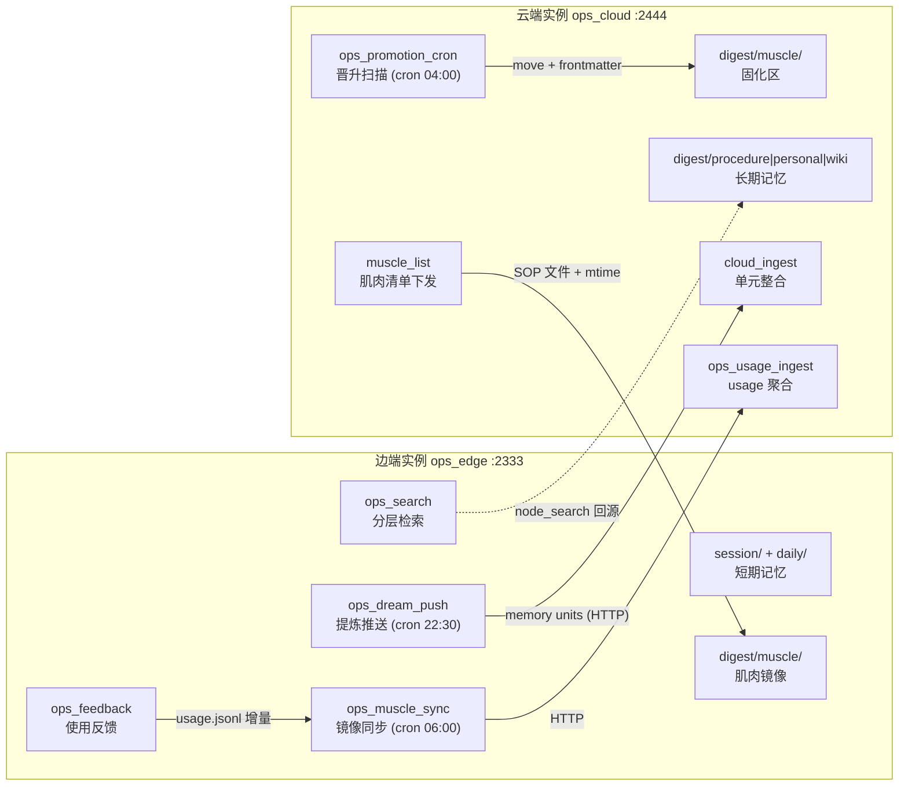

# 端云记忆协同设计（运维记忆模型）

ReMe2Ops 的端云协同：**端侧负责短期记忆**（快速检索、找最优解、提炼成长期记忆），**云端负责长期记忆**（知识沉淀），二者之间以「肌肉记忆」完成高频知识的固化与反射式下发。

## 1. 记忆模型

运维记忆按生命周期分为三类，分别落在 ReMe 工作区的不同层：

| 记忆类型 | 特征 | ReMe 落点 | 部署位置 |
|---|---|---|---|
| **肌肉记忆** | 长期且高效，类 SOP 与条件反射；高频调用、零网络延迟 | `digest/muscle/` 桶 | 云为主，端侧镜像 |
| **短期记忆** | 短期临时，事故/会话的原始上下文与工作记忆卡 | `session/`（原始 JSONL）+ `daily/`（工作记忆卡） | 端 |
| **长期记忆** | 大量知识低频访问；沉淀后的方法论、偏好、通识 | `digest/procedure` `digest/personal` `digest/wiki` | 云 |

两条单向流转规则：

- **短期 → 长期（提炼）**：夜间 dream 从 `daily/` 提取记忆单元，推送云端整合进 digest。提炼目标只允许 `procedure/personal/wiki`，**永远不允许直接写 `muscle`**（extract 提示词已显式排除，云端 ingest 会拒绝 muscle 桶的单元）。
- **长期 → 肌肉（固化）**：长期 SOP 被反复成功复用（usage 统计达标）后，由云端晋升进 `digest/muscle/`，随后下发边端镜像。肌肉记忆只能这样产生。

短期记忆与长期记忆的**索引连接**由三种机制构成：

1. dream 整合时在 digest 节点写入 `## Sources` 段落，用 wikilink 指回边端 `daily/...` 源文件（跨实例表现为悬挂链接，图谱保留为 virtual 节点——这正是「短期记忆建立索引连接到长期记忆上」的落点）；
2. 检索时 `expand_links` 沿 wikilink 图扩展一跳邻居，把相关长期知识拉进上下文；
3. 边端 `digest/muscle/` 镜像让高频长期知识在端侧物理存在，反射层检索即时命中。

## 2. 部署拓扑

MVP 以本地双实例模拟端云（同一台机器、不同端口与工作区），架构按真实端云设计：



启动方式（配置见 `reme/config/ops_edge.yaml`、`reme/config/ops_cloud.yaml`）：

```bash
# 端（云地址可用 OPS_CLOUD_HOST / OPS_CLOUD_PORT 覆盖）
reme start config=ops_edge service.port=2333 workspace_dir=/data/edge-workspace
# 云
reme start config=ops_cloud service.port=2444 workspace_dir=/data/cloud-workspace
```

## 3. 协同协议

### 3.0 连接器模式（客户端随时连接）

云端以**连接器服务**（`service.backend: ops_http`，`reme/steps/ops/connector.py`）运行：完整保留 HTTP/MCP 端点之外，新增两条路由——

- `WS /ops/connector`：持久会话。客户端发 `hello {device_id}`，云端回 `welcome`；此后云端**实时推送** `muscle.updated`（晋升即推，秒级下发），客户端随时可发 `usage.delta {records}` 直接上行使用记录（云端入库并自动快判，同一连接回 `usage.acked`）。
- `GET /ops/devices`：在线设备清单（device_id、连接时间、消息计数）。

协议共 6 种帧，任何语言/代理都能实现并**随时连接**：

| 帧 | 方向 | 说明 |
|---|---|---|
| `hello {device_id, capabilities}` | 客户端→云 | 握手注册；同 id 重连会替换旧会话 |
| `welcome {protocol, hint}` | 云→客户端 | 握手确认；客户端收到即做一次全量对账（sync） |
| `muscle.updated {paths, reason}` | 云→客户端 | 晋升/固化事件，实时广播给所有在线客户端 |
| `usage.delta {records}` | 客户端→云 | usage 增量，云端走 ops_usage_ingest（含决策模型快判） |
| `ping` / `pong` | 双向 | 保活 |
| `bye` | 客户端→云 | 主动断开 |

边端常驻 `ops_connector` 后台 job（`reme/steps/ops/connector_client.py`）：断线由 BackgroundJob 监护者以指数退避自动重连；**断线是常态而非错误**——离线客户端靠下次连接的 welcome 对账 + cron 同步兜底。不启用连接器（或无 `websockets` 依赖）时退回纯 HTTP 拉取模式。

### 3.1 HTTP API

云端地址由边端各 job 的 `cloud_host/cloud_port/cloud_timeout` 配置（支持环境变量），`reme/steps/ops/cloud.py` 的 `CloudClient` 用 httpx 直连 JSON 端点。

| 方向 | 端点 | 载荷 | 说明 |
|---|---|---|---|
| 端→云 | `POST /cloud_ingest` | `{units:[{name,bucket,summary,paths}], source_device, date}` | 提炼单元入库；`ops_ingest_seed_step` 校验后种入 `DreamState`，复用 `dream_integrate_step`+`auto_tag_step` 完成 CREATE/CORROBORATE/REFINE/CORRECT 语义整合 |
| 端→云 | `POST /ops_usage_ingest` | `{records:[{ts,path,outcome,...}]}` | usage 增量追加到云端聚合（`metadata/ops_usage/usage.jsonl`） |
| 端→云 | `POST /node_search` | `{query, limit}` | 分层检索第三层的长期知识回源 |
| 云→端 | `POST /muscle_list` | `{}` | 返回 muscle 桶文件清单 `{path, mtime_ns, size, content}` |
| 云内部 | `POST /ops_muscle_promote` | `{path}` | 单条晋升：`move`（自动重写所有入链 wikilink）+ frontmatter 标记 `memory_type: muscle` |
| 云内部 | `ops_promotion_cron` | — | 每日 04:00 聚合 usage，对 `digest/procedure/` 达标者晋升 |
| 端内部 | `POST /ops_search` | `{query, limit}` | 分层检索（见 §4） |
| 端内部 | `POST /ops_feedback` | `{path, outcome: solved\|failed, query?, session_id?}` | 记录使用效果 |
| 端内部 | `POST /ops_muscle_sync` | `{}` | 双向：usage 上行 + muscle 镜像下行（写/删 `digest/muscle/`，本地索引 watcher 自动感知） |
| 端内部 | `POST /ops_dream_push` | `{date?, scan_days?, max_units?, hint?, source_device?}` | 手动触发提炼推送（与 cron 相同步骤锚点） |

可靠性设计：

- **推送失败自动重试**：`ops_push_step` 把推送失败（或云端整合失败）单元的源路径并入 `DreamState.failed_paths`，`dream_finish_step` 按其断点语义不 checkpoint 这些路径，下次运行自动重新提取推送；重复推送安全，云端 node_search 语义去重。
- **镜像一致性**：远端 mtime 记录在边端 manifest（`metadata/ops_muscle_manifest.json`），不依赖本地文件 mtime（写入会改变它）；云不可达时镜像不动、usage 游标不推进，下次同步补齐。
- **无效输入防御**：云端 ingest 拒绝 muscle 桶单元（promotion-only）、未知桶路由 wiki、缺 name/summary/paths 的单元被拒并列出原因。

## 4. 分层检索与找最优解

`ops_search` 一次查询并行走三层，合并排序返回最优解：

| 层 | 数据源 | 权重（默认） | 意义 |
|---|---|---|---|
| muscle | 边端 `digest/muscle/`（BM25+向量混合） | 1.0 | 条件反射：已固化的 SOP，零网络 |
| daily | 边端 `daily/` | 0.6 | 短期工作记忆：最近事故上下文 |
| cloud | 云端 `node_search`（digest 全量） | 0.4 | 长期知识回源 |

排序公式：`score = Σ_tier w_tier/(rank+1) + β·solved`（rank 为该层内名次，β=usage_boost 默认 0.05）。「找最优解」的关键在第二项：**被反复验证成功的 SOP 会浮到最前**，而不只是字面最匹配的片段。云端不可达时前两层照常工作并降级提示；每层命中数、错误、usage 加权都记录在响应 `metadata` 中。

## 5. 使用反馈与固化闭环

```
ops_search 命中 → 现场使用 → ops_feedback{outcome}   （边端 metadata/ops_feedback/usage.jsonl）
   → ops_muscle_sync 上行增量（游标在 metadata/ops_feedback/sync_state.json）
      → 云端聚合 metadata/ops_usage/usage.jsonl
         → ops_promotion_cron：solved≥5 且 成功率≥0.8 → move 进 digest/muscle/
            → muscle_list 下发 → 边端镜像 → 下次直接反射命中
```

晋升阈值在 `ops_cloud.yaml` 的 `ops_promotion_scan_step` 参数（`min_solved/min_success_rate/max_promotions_per_run`）可调。晋升用 `move` job 完成，所有引用该 SOP 的 wikilink 自动重定向，短期记忆与长期知识的索引连接不断裂。

### 决策模型快判（快速肌肉记忆）

usage 慢路径之上叠加一条**决策模型快路径**：判定达标的 SOP 一次成功使用即可当日固化，不必等 5 次成功。判定器是可插拔的决策模型（`as_decision_model` 组件），对每个候选 SOP 提两个 binary 问题并取概率：

| 问题 | 判定内容 | 达标线（默认） |
|---|---|---|
| `muscle_worthy` | 是否条件反射级：步骤确定、可复用、可反射执行 | ≥ 0.8 |
| `evidence_sufficient` | usage 证据（solved/成功率）是否支持跳过慢路径 | ≥ 0.6 |

两个触发点：

1. **即时快判**：`ops_usage_ingest` 追加 usage 后，把本批次 solved 的非 muscle 路径交给 `ops_muscle_judge_step`，达标即 `ops_muscle_promote`（frontmatter 盖 `promoted_by: decision-model` + `judge_probability`）；
2. **晋升扫描 fast-track**：`ops_promotion_cron` 对 usage 低于阈值但 `solved ≥ fast_track_min_solved` 的 procedure，同样走决策模型判定晋升。

**反射卡生成**：晋升的 SOP 顶部由 LLM 生成一张紧凑 `## Reflex Card`（触发条件 → 3-8 条命令式动作 → 最易犯的错），全文保持不动，反射检索先读卡再读全文；卡片失败绝不影响晋升。

**失败安全**：判定器未配置 / 超时 / 拒答 / 网络错误一律记为「未判定」，自动回退 usage 慢路径——决策模型是加速器，不是依赖项。

**Laya 等决策模型接入**（`ops_cloud.yaml` 的 `components.as_decision_model.muscle`）：

```bash
# 任意 OpenAI 兼容 chat 端点（openai_chat backend，LLM-as-judge）
export DECISION_MODEL_BACKEND=openai_chat        # 默认
export DECISION_MODEL_BASE_URL=https://<laya-endpoint>/v1
export DECISION_MODEL_NAME=laya-xxx
export DECISION_MODEL_API_KEY=<key>

# 或 agentscope 分类器（TypeSafe Jev API / OpenAI Decisions API）
export DECISION_MODEL_BACKEND=agentscope         # 配 model_class: jev | openai
```


**usage 别名溯源**：晋升后文件路径从 `digest/procedure/x.md` 变为 `digest/muscle/x.md`，但晋升前的使用记录仍挂在旧路径上。`ops_muscle_promote_step` 在 frontmatter 写入 `promoted_from`，检索加权时（`combined_usage`）沿该别名把新旧两段 usage 合并计数，固化不丢失历史口碑。

## 5.1 论文驱动的演进（多目标 / scope 因子化 / 重放策略 / 幂等）

参考三篇论文将系统从「单阈值 + 快判」演进为四层机制：

**① 多目标 Tchebycheff 晋升**（Harmony Harness §4.1，MOEA/D 分解思想）
每个候选 SOP 三个原始目标：`rate`（成功率）、`solved`（成功用量）、`breadth`（上报设备数）。
`score = max_j λ_j · (1 − f_j / z*_j)`，`z*` 是**跨次运行持久化的理想点**
（`metadata/ops_promotion/ideal_point.json`，单调不缩）；`score ≤ score_threshold`
即达标。加权和不接受：最差目标持续承压，一个目标换另一个的候选不被录取。
min_solved/min_success_rate 退化为可行性预过滤，frontmatter 盖
`promoted_by: tchebycheff` + `promotion_score`。

**② scope 因子化 + generalize 算子**（Harmony §4.2/E.3）
muscle SOP frontmatter 增加 `scope: general | device:<id>`；`muscle_list`
按请求方 `for_device` 组装「general ∪ 自己」的视图，`muscle_sync` 携带设备身份
（OPS_DEVICE_ID/主机名），设备只收到对自己有意义的记忆。`ops_generalize`
（LLM 审计 job）周期性执行 promote/demote/keep：把错档的 SOP 移回正确 scope——
只改归档不改能力，失败退化为报告。

**③ 重放模拟器 + 策略 RSI**（Dream-RSI §3）
usage 历史按会话聚成「世界」（query → 命中 → solved/failed）。候选晋升策略
（min_solved / score_bar / 权重）离线回放：按时间推进全局 would-be-muscle 状态，
统计 **reflex hit**（已固化路径随后被 solved）与 **false reflex**（已固化却 failed）。
目标函数仿 Dream-RSI Eq.1：对 score_bar 做 budget 扫描取 (cost=晋升次数,
quality=reflex hits) 的非支配前沿**归一化超体积**，减去误反射率惩罚。
`ops_policy_evolve`（cron 03:30 + 手动）部署最优策略到
`metadata/ops_policy/policy.json`，晋升扫描将其作为运行时默认参数——
部署策略永远在候选池中，故从不回退；在线使用持续积累新的世界，闭环。

**④ 连接器恰好一次**（Apiary）
`usage.delta` 帧携带/派生 `event_id`，云端 `EventLedger`（`ops_events/events.jsonl`
+ seen 集合）去重：重发帧 acked `duplicate:true` 但不重复入库；所有广播帧落持久
事件日志——运维操作日志即数据，是重放模拟器的数据源。

## 5.2 第二轮演进：生命周期 / 设备画像 / 时间转移图 / 10 轮策略迭代

参考 whllowp/Knowledge memery 架构方案与 SHARP (arXiv 2611.14220)：

**① 肌肉生命周期 + 衰减降位**（memery 生命周期四态 + 可逆性阶梯）
muscle 只增不减会让过时 SOP 酿成事故。`ops_decay_scan`（cron 05:00 + 手动）计算热度
`heat = 0.4·exp(-ln2·age/14d) + 0.3·成功率 + 0.3·min(命中/cap, 1)`，低于冷线 0.25 的
SOP **降位**回 procedure 桶（move 保留文件，绝不删除）并盖墓碑
（`lifecycle: demoted` / `valid_until` / `demote_reason`），同时广播负向
`muscle.updated` 让在线边端立即下架镜像。重新晋升即字节级复活。
未知时间戳不获 recency 信用（保守判冷）。

**② 设备画像 ⟨P, C, S⟩**（SHARP §1 动态记忆库）
每设备一个画像文件（`metadata/ops_profile/<device>.md`）：P=长期环境画像，
C=近期上下文解读，S=确定性统计（`build_statistics`：命中分布/成功率/时段直方图）。
`ops_profile_step` 迭代更新 `P_n = Agent(T_new, P_{n-1}, S)`——每轮只看新增事件 +
**压缩后的旧画像**，输入有界（≤4000 字符，不随历史线性增长）；无 LLM 退化为纯统计
渲染（统计块替换而非追加）。版本号 + `derived_from` + `model_version` 溯源，
派生视图可重建。

**③ 时间感知转移图**（SHARP §2 多粒度视图）
usage 事件按设备时序构成「上一类别 → 下一类别」转移，落 4 类视图：
global(1) + 周型(2) + 时段桶(6) + 联合(12)。`ops_transitions` 重建图到
`metadata/ops_transitions/graphs.json`；`ops_search` 可选 `transition_boost`：
按当前时间选条件视图（联合 2×/单条件 1.5×/全局 1×加权）给命中 SOP 结构支持度加分——
「磁盘告警→清理手册」深夜高频这类被全局平滑抹掉的规律在检索中重新生效。

**④ 10 轮策略迭代**（Dream-RSI dreaming 扩展）
`ops_policy_evolve rounds=10`：每轮围绕在位策略做确定性变异（round 种子可复现）、
回放打分、部署轮最优（部署策略永远在池中，分数不回退），轮次曲线追加到
`metadata/ops_policy/evolution_log.jsonl`（round/best_score/deployed_score/redeployed）。
`ops_replay` 单步（rounds=1）保持向后兼容。

## 5.3 第三轮演进：做梦纠错 / 有界反射索引 / 做梦补缺 / 学习闭环

论文五组件落位（做梦纠错 Mt. Moon、promotion 与 MEMORY.md、做梦补缺第二次
dreaming pass、salience、学习闭环 CL-Bench 代际演进）：

**① 做梦纠错 + salience**（`ops_dream_audit`，端，cron 21:30 先审后推）
用 session transcript（`session_read`，usage 记录带 session_id 时）或原始 query
作 ground truth 复核 muscle 镜像，统一盖 `confirmed/unconfirmed/conflict` 章。
三个关键设计：**状态账本** `metadata/ops_audit/status.json`
（`{path: {status, verified_at, verified_by, correction, body_sha256}}`）是加权权威，
`body_sha256` 取 frontmatter 剥离后正文哈希；镜像 frontmatter 盖章仅为运维可见装饰，
被 `muscle_sync` 的 mtime 整体重写抹掉不影响加权（云端 CORRECT→同步重写→哈希失配→
自动重审）。**候选**=游标（`metadata/ops_audit/state.json`）后新 usage 证据（失败优先）
或正文哈希≠账本，截断于 `max_audit_per_run`。**salience** 以 job 级 hint kwarg 写在
`ops_dream_push`/`ops_dream_push_cron` 两个 job 上（cron 路径 `CronJob._execute_steps`
与 serve 路径 `BaseJob.__call__` 都把 job kwargs 并入 RuntimeContext，被
`extract.py` 的 `context.get("hint")` 读取；写进锚点 step 条目则到不了 context，
`ComponentConfig extra="allow"` 会静默吞键）——只记环境运行时读不到的规则/策略/教训、
失败教训优先。conflict 修正纪要落 `daily/<date>/ops-audit-<ts>.md`，经 22:30
`ops_dream_push` 走既有 CORRECT 语义修正云端长期副本。无 LLM 降级为纯报告。

**② 有界反射索引**（`ops_reflex_index`，端；追加进 `ops_muscle_sync_steps` 锚点末位）
MEMORY.md 式：每会话只注入索引头部——展示知道什么、去哪找，细节下沉留链接。
`metadata/ops_index/MEMORY.md` 硬封顶 200 行 / 25KB（`INDEX_MAX_LINES`/`INDEX_MAX_BYTES`），
条目=镜像路径+一句 description+账本哈希门控的 verified_status+scope，外加最近 daily
指针与「更多用 ops_search」指引；确定性渲染（无 LLM），同输入字节级一致，从镜像+账本
可随时重建。同步后自动重建：晋升/降位/推送经 `muscle.updated`→connector 对账、06:00
cron、手动 sync 全部触发。共享 Response 契约：job 内全部 step 复用同一
RuntimeContext/Response、按最终 `response.success` 记账，故本 step 只写
`metadata["reflex_index"]`，不碰 answer/success——sync 的 answer 与云不可达失败
状态不被掩蔽（link_repair 同此契约）。

**③ 做梦补缺**（`ops_link_repair`，云；挂 `ops_maintenance_cron` 05:00 与
decay/profile/transitions 同窗）
第二次 dreaming pass 修悬挂 wikilink：全部确定性不用 LLM；`daily/` 前缀目标跳过
（§1 的短期→长期溯源 virtual 节点是有意设计）；stem 相似度 ≥0.85 生成重定向
edit 计划（`[[悬空]]→[[既有]]`）；无匹配且入链 ≥2 才建 stub 页（`digest/wiki/`），
`max_repairs_per_run=5` 封顶——吸取论文博尔赫斯地图警示（wiki 膨胀到比源还大）。
只写 `metadata["link_repair"]`，降位仍由 lifecycle 热度扫描唯一裁决。

**④ 学习闭环**（`confirmed | unconfirmed | conflict` 全链路唯一词表）
常量 `VERIFIED_STATUS_VALUES` 单点定义于 `dream_audit.py`，audit 盖章、promote 默认章、
检索加权三处引用同一常量。写方=audit（账本 `verified_by` 记录所引 session/query，
即「如何知道该规则为真」）+ promote 默认 `verified_status: unconfirmed`（与
promoted_by 决策正交，陷阱警告已由 reflex_card pitfall 承接）。读方=`ops_search`：
`merge_tier_hits` 新增可选 `status_by_path/confirmed_boost/conflict_penalty`
（edge yaml 默认 0.05/0.15），**仅 muscle 层**参与——daily 是瞬态工作记忆、cloud
是远端不可本地读，均不加权；加权仅当镜像正文哈希与账本 `body_sha256` 一致时生效
（失配按 unconfirmed 中性处理，重写抹章场景免疫）。conflict 只降权+修正纪要，
降位仍由 lifecycle 唯一裁决——单裁判，避免竞态，保持 memery 可逆阶梯（绝不删除）。

## 5.4 第 1 轮演进：入库前防御扫描（端出云 redact + 云入库 block 双闸）

**入库前防御扫描**（`ops_defense_scan_step`，`reme/steps/ops/defense.py`；参考 Hindsight
Memory Defense——按库 opt-in 的 PII/secret 扫描，存储前脱敏或拦截）：纯 `re` pattern 包
（私钥块 / `sk-` / `ghp_` / AKIA / JWT / Slack / Bearer / api-key 赋值 / password·token·secret
赋值 / URL 内嵌凭据 / RFC1918 内网 IP），对 `DreamState.units` 的 name/summary 扫描，
无 LLM、命中值绝不落盘：

- **redact**（端侧第一道闸，`ops_dream_push` 锚点链插在 `dream_extract_step` 与
  `ops_push_step` 之间，cron 路径自动继承）：命中值改写为 `[REDACTED:<pattern>]` 占位，
  单元照常下行；
- **block**（云端第二道闸，`cloud_ingest` 链插在 `ops_ingest_seed_step` 之后；任意链路可配）：
  被拦单元源路径保留在 `processed_paths` 且不进 `failed_paths`——`dream_finish_step`
  按 checkpoint 消费（只查 "in processed and not in failed"）故一次性显式丢弃、不再重试：
  重提取只会再产出同一 secret，进 `failed_paths` 就是永夜重拦循环；被拦原因沿用 ingest
  既有 `metadata["rejected"]` 列表通道回流边端；
- **可审计**：block 时写 `daily/<date>/ops-defense-<ts>.md`（frontmatter
  `source: ops_defense_scan`，正文只记被拦路径 + pattern 类型）+ 响应 `metadata["defense"]`
  列全 mode/进出数/redacted/blocked/blocked_paths/note——丢弃可审计而非静默；
  报告写失败只记 `report_error`，不破坏 ingest。

无命中单元字节级直通；空 units 直通。验证：
`python -m pytest tests/unit/test_ops_defense.py tests/unit/test_ops_config_wiring.py -q` 全绿；
回归 `python -m pytest tests/unit -k ops -q` 全绿。

**第 2 轮：证据账本**（`ops_evidence`，云，`reme/steps/ops/evidence.py`；参考 Hindsight
Consolidation——信念保留 supporting evidence 精确引文与 proof count，新证据
strengthen/weaken/extend 而非覆盖）：把 dream-integrate 既有 CORROBORATE/REFINE/CORRECT
语义从「只在节点正文」升级为结构化账本 `metadata/ops_evidence/ledger.json`——
`{path: {sources, proof_count, conflict_count, last_conflict_at}}`。确定性无 LLM：
`sources` = 解析 digest 节点 `## Sources` 段 wikilink（精确引文=指回边端 daily 的溯源链接，
去重排序，非 h2 标题/段外链接不计）；`proof_count` = 去重来源数；`conflict_count` /
`last_conflict_at` = 云端 usage 聚合（`usage.py` 的 `read_usage_records` + `aggregate_usage`
仅取 failed outcome，weakening 信号）。每次运行整体重建——幂等（同输入同 JSON 字节）、
读侧损坏容错——extend-not-overwrite 由推导本身保证；为第 10 轮排序校准与后续检索加权供数。
落点：`enable_serve` job + 追加进 `ops_maintenance_cron` 05:00 链末位（先 link_repair 后建账，
看到修复后的图）；共享 Response 契约只写 `metadata["ops_evidence"]`。验证：
`python -m pytest tests/unit/test_ops_evidence.py -q` 全绿；回归 `test_ops_link_repair.py`
（同 cron 窗口契约）全绿。

**第 3 轮：证据独立性去重**（`usage.py`/`multi_objective.py`/`promote.py`/`replay.py`；参考
Sage-Taiyi arXiv 2611.12762v2 §监控——多个 idea 共享同一未检验前提时，其一致不构成独立
支持）：修「同一次会话里反复跑通同一 SOP 被当成多会话级证据」的系统性偏差。关键签名
（评审 finding3 采纳）：`aggregate_usage(records, *, session_dedupe=False)` 默认关时输出与
现状逐字节一致（test_ops_usage 的 7 键精确全等断言原样保持绿），开时才增
`distinct_session_solved` 键——显式 opt-in 而非无条件加键，兼容性由签名保证而非改测试；
共享计数纯函数 `solved_session_key`（session id 是证据单元，无 session 的 solved 各自计，
回退原计数）。`objective_vector`/`rank_promotion_candidates` 加 `independent_only` 开关：
solved 目标读独立计数、键缺席回退原计数；`min_solved` 可行性地板与 breadth 目标保持 raw
不受影响。`ops_promotion_scan_step` 加同名 kwarg（默认 false，部署口径而非 policy 可调），
开启时以 `session_dedupe=True` 聚合；`replay_once` 同名参数使回放与在线同语义，返回增
opt-in `distinct_solved_by_path`；`ops_promotion_cron` scan step 配 `independent_only: true`。
（复核修正：`replay_score` 与 `OpsReplayStep` 透传同名参数，`&ops_policy_steps` 锚点的
`ops_replay_step` 配同值 true——做梦调参必须基于扫描实际使用的计数口径，否则部署策略
指向一个它永远不会再遇到的语义。）
finding6 采纳：replay（固定 IDEAL_FLOOR）与 scan（持久化只增理想点）的判定等价收窄为两层——
计数层共用同一纯函数恒等 + 决策层等价仅在测试钉住 ideal_point.json 时断言。验证：
`pytest tests/unit/test_ops_independence.py tests/unit/test_ops_multi_objective.py
tests/unit/test_ops_usage.py tests/unit/test_ops_replay.py -q` 全绿；回归
`test_ops_promote.py` 全绿。

**第 4 轮：来源反向索引**（`ops_source_index`，云，`reme/steps/ops/source_index.py`；参考
Sage-Taiyi §Evidence State——evidence 链接来源与条件，新证据只修订受影响的 judgments）：
与第 2 轮证据账本互补——账本=每节点正视角（谁支撑我），索引=每来源反视角（我支撑谁）。
落 `metadata/ops_source_index.json`：`{source_path: [citing nodes]}`（解析复用第 2 轮
`evidence.extract_sources`/`read_node_body`，直接读文件不依赖 get_nodes 图谱；
`daily/` 悬空目标照常收录——virtual 溯源节点是有意设计，不修复不丢弃）+ 纯函数
`affected_nodes(index, source_path)`（定向修订集：某 daily 源被修正时需回访的 judgments）
+ `shared_source_nodes` 报告（被 ≥2 节点引用的来源=共享前提证据，呼应 Taiyi
「共享未检验前提的一致不构成独立支持」），确定性幂等重建、读侧损坏容错，共享 Response
契约只写 `metadata["source_index"]`。落点：`enable_serve` job + 追加进
`ops_maintenance_cron` 05:00 链末位（证据账本之后，同看修复后图）；为后备条目
（CORRECT 定向传播）供结构。验证：`pytest tests/unit/test_ops_source_index.py -q` 全绿；
回归 `test_ops_dream_audit.py` 全绿。

**第 5 轮：失败笔记固化**（`ops_failure_notes`，云，`reme/steps/ops/failure_notes.py`；参考
JARVIS-1 跨 epoch 自我改进——epoch1 缺熔炉失败→epoch2 补步骤→epoch3 备燃料，每次失败让
下一次执行更充分）：补齐失败证据的「写回路」——此前失败只进 usage.jsonl 计数与 audit 候选，
SOP 正文不吸收教训。扫云端 usage 聚合的 failed 记录，把 (日期, query) 合并为对应 SOP 的
`## Failure Notes` 节（同 query 去重取最新、最新在上、封顶 5 条挤掉最旧）+ frontmatter
`failure_count`；改写既有文件且仅当合并后正文确有变化（无 mtime 空转）。目标解析（评审
finding4 采纳）：usage 路径在云端存在→直写；不存在（晋升 move 过）→扫 muscle 目录按
frontmatter `promoted_from` 别名找正本写入（muscle 正本是唯一 canonical，检索侧
`tiered_search` 同字段同向）；两者皆无→跳过并列入 `metadata["failure_notes"]["skipped"]`。
本 step 只改写、绝不创建文件——杜绝「旧 procedure 路径被重建→晋升扫描按前缀再计分→
move(overwrite=True) 覆盖 muscle 正本」的双正本破坏链。muscle 正本变更经既有 mtime 同步→
边端哈希失配→re-audit 链条自然闭环。落点：`enable_serve` job + `ops_maintenance_cron`
05:00 链内 link_repair 之后（evidence/source_index 之前，让派生视图看到更新后的正文）。
验证：`pytest tests/unit/test_ops_failure_notes.py -q` 全绿；回归 `test_ops_promote.py` 全绿。

**第 6 轮：检索前置检查**（`tiered_search.py` + `reflex_index.py`，端；参考 JARVIS-1
执行前校验——epoch3「多挖一根原木作燃料」就是执行前核对既往失败，配合第 5 轮失败笔记
形成「失败→笔记→下次执行前必读」闭环）：纯展示层，不进排序——降权/升权仍由 usage_boost
与 verified 加权唯一裁决，避免第三个裁判竞态。`merge_tier_hits` 增可选 `failure_by_path`：
命中条目附 `preflight: {failure_count}` 字段（分数与排名不变，无失败/缺席不加字段）；
`OpsSearchStep` 由 `preflight_warnings` 开关（`ops_edge.yaml` 的 `ops_search_step` 配 true）
从 muscle 命中项 frontmatter `failure_count>0` 收集（`_frontmatter_flags` 同一 get_nodes
趟次顺带收集），写入响应 `metadata["preflight"]` 并在 answer 命中项标题下追加
`[preflight] N failure note(s)` 警示行；`reflex_index` 的 `index_entries` 增 `has_failures`
标记、索引行尾渲染 `[F]` 旗标（行数预算 200 行/25KB 不变）。依赖第 5 轮 frontmatter
（别名解析后写的是 muscle 正本，随 mtime 同步自然到达边端镜像）；独立交付时字段缺席即
自动关闭。验证：`pytest tests/unit/test_ops_preflight.py tests/unit/test_ops_reflex_index.py
-q` 全绿；回归 `test_ops_tiered_search.py` 全绿。

**第 7 轮：会话态检索键**（`tiered_search.py`，端；参考 MATM arXiv 2606.19911 §3.1——状态
条件化索引，检索键=任务描述+最近 l 步轨迹，消费者按当前状态检索比按原始任务更有用）：
`transition_boost` 通路原要求调用方传 `last_category`（tiered_search 旧逻辑），运维代理很少
传导致结构支持度近乎闲置。新增纯函数 `infer_last_category(records, session_id)`：取该
session（缺省全局）最近一条 usage 命中的 `category_of` 作 last_category（ts 最高者胜、平局
取后出现的记录、无命中返回空串）；`OpsSearchStep` 在调用方未传 `last_category` 且
`infer_last_category` 开关开、`transition_boost>0` 时启用，从已读取的边端本地 usage 记录
推断（零网络请求，纯确定性），推断结果写 `metadata["inferred_last_category"]`；显式传入
last_category 时调用方永远优先，无历史则行为与现状逐位一致。落点：
`ops_edge.yaml` 的 `ops_search_step` 配 `infer_last_category: true` **和**
`transition_boost: 0.1`——两键缺一不可（复核修正：boost 只读 step 配置与 RuntimeContext，
yaml 缺 transition_boost 时推断开关是死配置）。验证：
`pytest tests/unit/test_ops_state_retrieval.py tests/unit/test_ops_transitions.py -q` 全绿；
回归 `test_ops_tiered_search.py` 全绿。

**第 8 轮：检索规划闸**（`tiered_search.py`，端；参考 MATM §4.3 RetrievalPlanner 逐步决定
[Retrieval]/[NoRetrieval]——避免检索稀释上下文，论文规划器本身可换成启发式，此处即确定性
规则、无 LLM）：纯函数 `should_call_cloud(muscle_top, usage_stats, threshold)`，判据全部
无量纲（评审 finding2 采纳，检索分非归一化且量纲随 query/单双分支改变，绝不做阈值）：
(a) 证据闸——muscle top 命中 usage `solved ≥ cloud_gate_min_solved` 且
`success_rate ≥ cloud_gate_min_rate`（反射级证据而非检索分，默认 3/0.8）；(b) 相对优势闸
（证据薄时回退）——层内 `top1/(top1+top2) ≥ cloud_gate_dominance`（同层同量纲，比值即
归一化，默认 0.7）。闸开启时三层并发 gather 改两段式：本地先行、闸未触发再回源——
时延代价如实标注（finding2）：未触发路径从 max(本地,云端) 变为 本地+云端，「降时延」只在
触发方向成立；闸只省调用、不缩小已发起层候选池（MATM §5.4 跨任务结论的对应约束）、
不参与加权（排序仍由 usage_boost 与 verified 唯一裁决），与 cloud 回源/transition_boost/
verified 加权全部正交。闸默认关（`ops_edge.yaml` 的 `ops_search_step` 配
`cloud_gate_min_solved: 0`，注释给出开启示例 `3` 与代价说明），交付零行为变化；云端不可达
的降级提示语义不受闸影响。验证：`pytest tests/unit/test_ops_cloud_gate.py
tests/unit/test_ops_tiered_search.py -q` 全绿。

**第 9 轮：策略基因组扩展**（`evolution.py`，云；参考 Sage-Taiyi §认知库——可复用单元是
「方法/启发式」而非情节，策略方法的搜索空间应比阈值更宽）：10 轮策略做梦的
`mutate_params` 原本只抖 min_solved/score_bar/min_success_rate 三个阈值（replay.py 的
`policy_params` 早已携带 weights/solved_cap 却从不被变异——方法空间比实现更宽，低垂果实）。
新增：λ_rate/λ_solved/λ_breadth ±20% 乘性抖动后经 `normalize_weights` 归一——末项取精确
补、地柜 0.01、正权重再窃取，三者和恒为 1（Tchebycheff 分解语义不变）；solved_cap
±1.0 有界抖动，clamp [1,50]。`default_candidate_grid` 增权重混合与 cap 候选且置于池首
（版本截断 cap=12 不会丢掉它们）；新 kwarg `mutate_weights`（默认 false 完全向后兼容，
`ops_cloud.yaml` 的 `&ops_policy_steps` 锚点配 true，cron 自动继承）。round 种子可复现
（同 round 同候选集与分数）、rng 抽取顺序固定、deployed 永在池中分数不回退（既有约束
回归覆盖）。验证：`pytest tests/unit/test_ops_replay.py -q` 全绿；回归
`test_ops_promote.py` 全绿。

**第 10 轮：检索加权参数做梦校准 + 云→边部署通道**（`ranking_calib.py` 新增，
`muscle_list`/`muscle_sync`/`tiered_search` 扩展；参考 MATM §3.2 LTRT——按边际效用
ℓ=s_aug−s_base 排序，标签由增量构建过程同时产生，对应离线回放用 outcome 差校准排序参数）：
纯函数 `calibrate_ranking_params(trees, grid)` 按候选 boost 向量回放世界，目标=「
would-be-muscle 路径的 solved 事件中按代理排序（累计 solved×(1+usage_boost)−failed×
conflict_penalty，词法分的确定性近似——注释已声明）居 top-1 的比例」，代理晋升地板
(2, 0.5) 故意松于真实晋升（失败路径必须在册，conflict_penalty 才有可校准对象）；候选缩到
(objective↑, boost L1↓) 非支配前沿，`ops_ranking_calibrate_step` 落云端
`metadata/ops_policy/ranking.json`（无 worlds/无 muscle solved 事件则跳过不写——部署
零向量会静默禁用权重）。**部署半环补齐**（评审 finding1 采纳）：muscle_list 响应
`metadata["policy"]["ranking"]` 原样携带该文件（复用既有端点不新增路由，清单不变）；
muscle_sync 收到 policy 块落边端同名快照，云端缺席/字段缺失保留边端现存快照；search
boost 三级优先级=显式 kwargs > 边端部署快照 > 内置默认（与 promote.py 同款契约），内置
引导值收进代码（0.05/0.05/0.15），`ops_edge.yaml` 移除三个显式 boost 键（否则显式值恒压
部署值、校准永不生效）。不新增加权项，只让三个既有权重由 dreaming 数据驱动并可到达边端。
验证：`pytest tests/unit/test_ops_ranking_calib.py tests/unit/test_ops_tiered_search.py
tests/unit/test_ops_scope.py tests/unit/test_ops_muscle_sync.py tests/unit/test_ops_replay.py
-q` 全绿；全链路 `scripts/ops_demo.py` 七阶段可手验（需双实例）。

## 6. 目录与文件清单

```
reme/steps/ops/
├── connector.py      # 云端连接器：ConnectorRegistry + ops_http 服务（WS + presence）
├── connector_client.py # 边端常驻连接 job：实时推送感知、断线重连、welcome 对账
├── cloud.py          # CloudClient (httpx) + cloud_settings
├── tiered_search.py  # ops_search_step + 合并排序纯函数
├── feedback.py       # ops_feedback_step（边）
├── push.py           # ops_push_step（边，断点重试语义）
├── ingest.py         # ops_ingest_seed_step（云，单元校验）
├── defense.py        # ops_defense_scan_step（入库前防御扫描：PII/secret 正则脱敏/拦截）
├── evidence.py       # ops_evidence_step（云，证据账本：proof/conflict 结构化计数器）
├── source_index.py   # ops_source_index_step（云，来源反向索引：source → 引用节点 + shared 报告）
├── failure_notes.py  # ops_failure_notes_step（云，失败笔记固化：正文写回 + promoted_from 别名解析）
├── ranking_calib.py  # ops_ranking_calibrate_step（云，检索加权做梦校准 + ranking.json 部署）
├── muscle_list.py    # ops_muscle_list_step（云）
├── usage_ingest.py   # ops_usage_ingest_step（云）+ 快判候选提取
├── muscle_sync.py    # ops_muscle_sync_step（边，manifest 差异同步）
├── dream_audit.py    # ops_dream_audit_step（边，做梦纠错：transcript 复核 + 状态账本）
├── reflex_index.py   # ops_reflex_index_step（边，200 行/25KB 有界反射索引，确定性渲染）
├── link_repair.py    # ops_link_repair_step（云，悬挂 wikilink 重定向 + 入链门槛 stub，确定性）
├── judge.py          # ops_muscle_judge_step（云，决策模型快判，失败安全）
├── reflex_card.py    # ops_reflex_card_step（云，反射卡生成，双语提示词）
├── promote.py        # ops_muscle_promote_step / ops_promotion_scan_step（多目标 Tchebycheff + policy.json）
├── multi_objective.py # Tchebycheff 评分 + 理想点持久化 + 候选排序（纯函数）
├── generalize.py     # ops_generalize_step（scope 审计，promote/demote/keep）
├── replay.py         # 会话世界构建 + 策略回放评分（超体积 − 误反射惩罚）
├── evolution.py      # ops_replay(rounds=N) / ops_policy_evolve（10 轮 dreaming 曲线）
├── lifecycle.py      # ops_decay_scan_step（热度衰减 + 降位墓碑 + 负向广播）
├── profile.py        # ops_profile_step（SHARP 设备画像 ⟨P,C,S⟩ 有界迭代）
├── transitions.py    # 时间感知转移图（4 类视图）+ 检索结构支持度
└── usage.py          # usage 记录存储与聚合（含设备维度）纯函数

reme/components/as_decision_model/
├── openai_chat.py    # openai_chat backend：任意 OpenAI 兼容端点的 LLM-as-judge
└── agentscope.py     # agentscope backend：model_class = jev | openai

reme/config/ops_edge.yaml   # 端配置（禁本地 dream，新增 ops job + 2 cron）
reme/config/ops_cloud.yaml  # 云配置（禁 dream/proactive，新增 ingest/promote job + 晋升 cron）
reme/enumeration/dream_bucket_enum.py   # +MUSCLE 桶（仅晋升可达）
reme/steps/index/graph_snapshot.py      # muscle 分类根（web 图谱）
reme/steps/evolve/dream/extract.py|.yaml# 提炼排除 muscle 桶
scripts/ops_demo.py                     # 七阶段端到端演示
tests/unit/test_ops_*.py + test_ops_config_wiring.py + test_decision_backends.py   # 单元测试（含接线 smoke）
```

## 7. 验证

```bash
# 单元测试
python -m pytest tests/unit -k ops -q
# 双实例 + 全链路（需 LLM_API_KEY 等环境变量）
reme start config=ops_edge service.port=2333 workspace_dir=/tmp/edge-ws &
reme start config=ops_cloud service.port=2444 workspace_dir=/tmp/cloud-ws &
python scripts/ops_demo.py
```

演示七阶段：seed（写事故会话）→ search（三层检索）→ push（提炼上云）→ feedback（记录使用）→ promote（固化）→ sync（镜像下发）→ reflex（同一查询命中本地肌肉记忆）。

## 8. 生产化路线（MVP 未含）

- **鉴权与传输**：当前 HTTP API 无鉴权、CORS 全开。上云时给云端实例加 API-key 依赖/中间件（子类化 `HttpService.build_service`）或前置反向代理，并经 `service:` uvicorn kwargs 配 TLS。
- **多端接入**：`cloud_ingest.source_device` 已预留设备标签；usage 聚合可按设备分桶后再聚合，避免单设备噪声影响晋升。
- **向量化**：默认 BM25 即可用；云端开 embedding（`as_embedding`/`embedding_store` 组件）提升跨表述检索质量，边端可选 FAISS 后端加速肌肉层。
- **肌肉记忆的可执行化**：muscle 桶 SOP 可导出为 SKILL.md 技能（如 dsh-memory-evolve-ops 的技能库），使「条件反射」从检索命中进一步变为直接执行——这是与 DSH 插件生态衔接的后续方向。
- **观测**：`job_status` 可查 cron/后台任务执行历史；后续可加 usage 面板与晋升审计日志。
