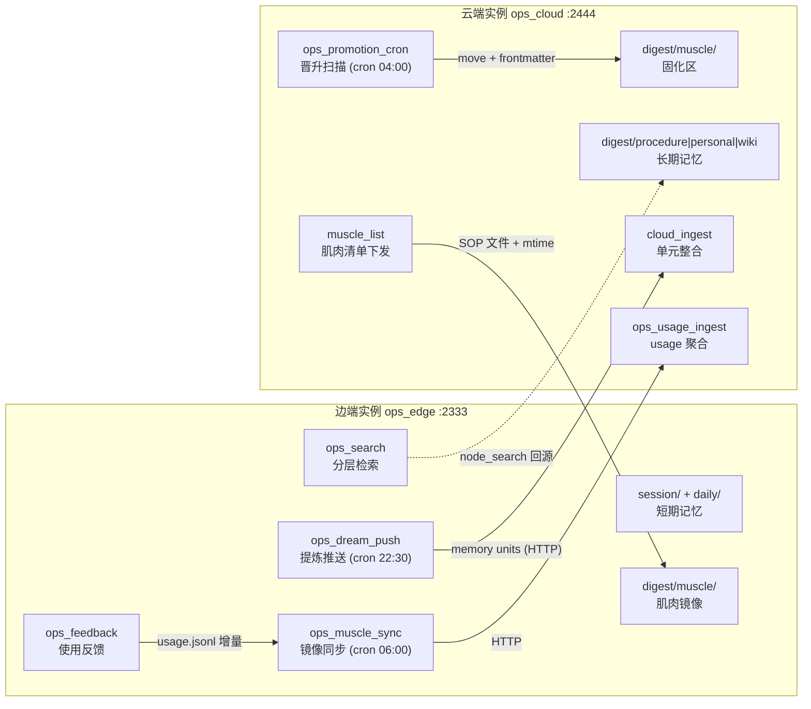

# 端云记忆协同设计（运维记忆模型）

ReMe2Ops 的端云协同：**端侧负责短期记忆**（快速检索、找最优解、提炼成长期记忆），**云端负责长期记忆**（知识沉淀），二者之间以「肌肉记忆」完成高频知识的固化与反射式下发。

## 1. 记忆模型

运维记忆按生命周期分为三类，分别落在 ReMe 工作区的不同层：

| 记忆类型 | 特征 | ReMe 落点 | 部署位置 |
|---|---|---|---|
| **肌肉记忆** | 长期且高效，类 SOP 与条件反射；高频调用、零网络延迟 | `digest/muscle/` 桶 | 云为主，端侧镜像 |
| **短期记忆** | 短期临时，事故/会话的原始上下文与工作记忆卡 | `session/`（原始 JSONL）+ `daily/`（工作记忆卡） | 端 |
| **长期记忆** | 大量知识低频访问；沉淀后的方法论、偏好、通识 | `digest/procedure` `digest/personal` `digest/wiki` | 云 |

两条单向流转规则：

- **短期 → 长期（提炼）**：夜间 dream 从 `daily/` 提取记忆单元，推送云端整合进 digest。提炼目标只允许 `procedure/personal/wiki`，**永远不允许直接写 `muscle`**（extract 提示词已显式排除，云端 ingest 会拒绝 muscle 桶的单元）。
- **长期 → 肌肉（固化）**：长期 SOP 被反复成功复用（usage 统计达标）后，由云端晋升进 `digest/muscle/`，随后下发边端镜像。肌肉记忆只能这样产生。

短期记忆与长期记忆的**索引连接**由三种机制构成：

1. dream 整合时在 digest 节点写入 `## Sources` 段落，用 wikilink 指回边端 `daily/...` 源文件（跨实例表现为悬挂链接，图谱保留为 virtual 节点——这正是「短期记忆建立索引连接到长期记忆上」的落点）；
2. 检索时 `expand_links` 沿 wikilink 图扩展一跳邻居，把相关长期知识拉进上下文；
3. 边端 `digest/muscle/` 镜像让高频长期知识在端侧物理存在，反射层检索即时命中。

## 2. 部署拓扑

MVP 以本地双实例模拟端云（同一台机器、不同端口与工作区），架构按真实端云设计：



启动方式（配置见 `reme/config/ops_edge.yaml`、`reme/config/ops_cloud.yaml`）：

```bash
# 端（云地址可用 OPS_CLOUD_HOST / OPS_CLOUD_PORT 覆盖）
reme start config=ops_edge service.port=2333 workspace_dir=/data/edge-workspace
# 云
reme start config=ops_cloud service.port=2444 workspace_dir=/data/cloud-workspace
```

## 3. 协同协议（HTTP API）

云端地址由边端各 job 的 `cloud_host/cloud_port/cloud_timeout` 配置（支持环境变量），`reme/steps/ops/cloud.py` 的 `CloudClient` 用 httpx 直连 JSON 端点。

| 方向 | 端点 | 载荷 | 说明 |
|---|---|---|---|
| 端→云 | `POST /cloud_ingest` | `{units:[{name,bucket,summary,paths}], source_device, date}` | 提炼单元入库；`ops_ingest_seed_step` 校验后种入 `DreamState`，复用 `dream_integrate_step`+`auto_tag_step` 完成 CREATE/CORROBORATE/REFINE/CORRECT 语义整合 |
| 端→云 | `POST /ops_usage_ingest` | `{records:[{ts,path,outcome,...}]}` | usage 增量追加到云端聚合（`metadata/ops_usage/usage.jsonl`） |
| 端→云 | `POST /node_search` | `{query, limit}` | 分层检索第三层的长期知识回源 |
| 云→端 | `POST /muscle_list` | `{}` | 返回 muscle 桶文件清单 `{path, mtime_ns, size, content}` |
| 云内部 | `POST /ops_muscle_promote` | `{path}` | 单条晋升：`move`（自动重写所有入链 wikilink）+ frontmatter 标记 `memory_type: muscle` |
| 云内部 | `ops_promotion_cron` | — | 每日 04:00 聚合 usage，对 `digest/procedure/` 达标者晋升 |
| 端内部 | `POST /ops_search` | `{query, limit}` | 分层检索（见 §4） |
| 端内部 | `POST /ops_feedback` | `{path, outcome: solved\|failed, query?, session_id?}` | 记录使用效果 |
| 端内部 | `POST /ops_muscle_sync` | `{}` | 双向：usage 上行 + muscle 镜像下行（写/删 `digest/muscle/`，本地索引 watcher 自动感知） |
| 端内部 | `POST /ops_dream_push` | `{date?, scan_days?, max_units?, hint?, source_device?}` | 手动触发提炼推送（与 cron 相同步骤锚点） |

可靠性设计：

- **推送失败自动重试**：`ops_push_step` 把推送失败（或云端整合失败）单元的源路径并入 `DreamState.failed_paths`，`dream_finish_step` 按其断点语义不 checkpoint 这些路径，下次运行自动重新提取推送；重复推送安全，云端 node_search 语义去重。
- **镜像一致性**：远端 mtime 记录在边端 manifest（`metadata/ops_muscle_manifest.json`），不依赖本地文件 mtime（写入会改变它）；云不可达时镜像不动、usage 游标不推进，下次同步补齐。
- **无效输入防御**：云端 ingest 拒绝 muscle 桶单元（promotion-only）、未知桶路由 wiki、缺 name/summary/paths 的单元被拒并列出原因。

## 4. 分层检索与找最优解

`ops_search` 一次查询并行走三层，合并排序返回最优解：

| 层 | 数据源 | 权重（默认） | 意义 |
|---|---|---|---|
| muscle | 边端 `digest/muscle/`（BM25+向量混合） | 1.0 | 条件反射：已固化的 SOP，零网络 |
| daily | 边端 `daily/` | 0.6 | 短期工作记忆：最近事故上下文 |
| cloud | 云端 `node_search`（digest 全量） | 0.4 | 长期知识回源 |

排序公式：`score = Σ_tier w_tier/(rank+1) + β·solved`（rank 为该层内名次，β=usage_boost 默认 0.05）。「找最优解」的关键在第二项：**被反复验证成功的 SOP 会浮到最前**，而不只是字面最匹配的片段。云端不可达时前两层照常工作并降级提示；每层命中数、错误、usage 加权都记录在响应 `metadata` 中。

## 5. 使用反馈与固化闭环

```
ops_search 命中 → 现场使用 → ops_feedback{outcome}   （边端 metadata/ops_feedback/usage.jsonl）
   → ops_muscle_sync 上行增量（游标在 metadata/ops_feedback/sync_state.json）
      → 云端聚合 metadata/ops_usage/usage.jsonl
         → ops_promotion_cron：solved≥5 且 成功率≥0.8 → move 进 digest/muscle/
            → muscle_list 下发 → 边端镜像 → 下次直接反射命中
```

晋升阈值在 `ops_cloud.yaml` 的 `ops_promotion_scan_step` 参数（`min_solved/min_success_rate/max_promotions_per_run`）可调。晋升用 `move` job 完成，所有引用该 SOP 的 wikilink 自动重定向，短期记忆与长期知识的索引连接不断裂。

### 决策模型快判（快速肌肉记忆）

usage 慢路径之上叠加一条**决策模型快路径**：判定达标的 SOP 一次成功使用即可当日固化，不必等 5 次成功。判定器是可插拔的决策模型（`as_decision_model` 组件），对每个候选 SOP 提两个 binary 问题并取概率：

| 问题 | 判定内容 | 达标线（默认） |
|---|---|---|
| `muscle_worthy` | 是否条件反射级：步骤确定、可复用、可反射执行 | ≥ 0.8 |
| `evidence_sufficient` | usage 证据（solved/成功率）是否支持跳过慢路径 | ≥ 0.6 |

两个触发点：

1. **即时快判**：`ops_usage_ingest` 追加 usage 后，把本批次 solved 的非 muscle 路径交给 `ops_muscle_judge_step`，达标即 `ops_muscle_promote`（frontmatter 盖 `promoted_by: decision-model` + `judge_probability`）；
2. **晋升扫描 fast-track**：`ops_promotion_cron` 对 usage 低于阈值但 `solved ≥ fast_track_min_solved` 的 procedure，同样走决策模型判定晋升。

**反射卡生成**：晋升的 SOP 顶部由 LLM 生成一张紧凑 `## Reflex Card`（触发条件 → 3-8 条命令式动作 → 最易犯的错），全文保持不动，反射检索先读卡再读全文；卡片失败绝不影响晋升。

**失败安全**：判定器未配置 / 超时 / 拒答 / 网络错误一律记为「未判定」，自动回退 usage 慢路径——决策模型是加速器，不是依赖项。

**Laya 等决策模型接入**（`ops_cloud.yaml` 的 `components.as_decision_model.muscle`）：

```bash
# 任意 OpenAI 兼容 chat 端点（openai_chat backend，LLM-as-judge）
export DECISION_MODEL_BACKEND=openai_chat        # 默认
export DECISION_MODEL_BASE_URL=https://<laya-endpoint>/v1
export DECISION_MODEL_NAME=laya-xxx
export DECISION_MODEL_API_KEY=<key>

# 或 agentscope 分类器（TypeSafe Jev API / OpenAI Decisions API）
export DECISION_MODEL_BACKEND=agentscope         # 配 model_class: jev | openai
```


**usage 别名溯源**：晋升后文件路径从 `digest/procedure/x.md` 变为 `digest/muscle/x.md`，但晋升前的使用记录仍挂在旧路径上。`ops_muscle_promote_step` 在 frontmatter 写入 `promoted_from`，检索加权时（`combined_usage`）沿该别名把新旧两段 usage 合并计数，固化不丢失历史口碑。

## 6. 目录与文件清单

```
reme/steps/ops/
├── cloud.py          # CloudClient (httpx) + cloud_settings
├── tiered_search.py  # ops_search_step + 合并排序纯函数
├── feedback.py       # ops_feedback_step（边）
├── push.py           # ops_push_step（边，断点重试语义）
├── ingest.py         # ops_ingest_seed_step（云，单元校验）
├── muscle_list.py    # ops_muscle_list_step（云）
├── usage_ingest.py   # ops_usage_ingest_step（云）+ 快判候选提取
├── muscle_sync.py    # ops_muscle_sync_step（边，manifest 差异同步）
├── judge.py          # ops_muscle_judge_step（云，决策模型快判，失败安全）
├── reflex_card.py    # ops_reflex_card_step（云，反射卡生成，双语提示词）
├── promote.py        # ops_muscle_promote_step / ops_promotion_scan_step（云，含 fast-track）
└── usage.py          # usage 记录存储与聚合纯函数

reme/components/as_decision_model/
├── openai_chat.py    # openai_chat backend：任意 OpenAI 兼容端点的 LLM-as-judge
└── agentscope.py     # agentscope backend：model_class = jev | openai

reme/config/ops_edge.yaml   # 端配置（禁本地 dream，新增 ops job + 2 cron）
reme/config/ops_cloud.yaml  # 云配置（禁 dream/proactive，新增 ingest/promote job + 晋升 cron）
reme/enumeration/dream_bucket_enum.py   # +MUSCLE 桶（仅晋升可达）
reme/steps/index/graph_snapshot.py      # muscle 分类根（web 图谱）
reme/steps/evolve/dream/extract.py|.yaml# 提炼排除 muscle 桶
scripts/ops_demo.py                     # 七阶段端到端演示
tests/unit/test_ops_*.py + test_decision_backends.py   # 55 个单元测试
```

## 7. 验证

```bash
# 单元测试
python -m pytest tests/unit -k ops -q
# 双实例 + 全链路（需 LLM_API_KEY 等环境变量）
reme start config=ops_edge service.port=2333 workspace_dir=/tmp/edge-ws &
reme start config=ops_cloud service.port=2444 workspace_dir=/tmp/cloud-ws &
python scripts/ops_demo.py
```

演示七阶段：seed（写事故会话）→ search（三层检索）→ push（提炼上云）→ feedback（记录使用）→ promote（固化）→ sync（镜像下发）→ reflex（同一查询命中本地肌肉记忆）。

## 8. 生产化路线（MVP 未含）

- **鉴权与传输**：当前 HTTP API 无鉴权、CORS 全开。上云时给云端实例加 API-key 依赖/中间件（子类化 `HttpService.build_service`）或前置反向代理，并经 `service:` uvicorn kwargs 配 TLS。
- **多端接入**：`cloud_ingest.source_device` 已预留设备标签；usage 聚合可按设备分桶后再聚合，避免单设备噪声影响晋升。
- **向量化**：默认 BM25 即可用；云端开 embedding（`as_embedding`/`embedding_store` 组件）提升跨表述检索质量，边端可选 FAISS 后端加速肌肉层。
- **肌肉记忆的可执行化**：muscle 桶 SOP 可导出为 SKILL.md 技能（如 dsh-memory-evolve-ops 的技能库），使「条件反射」从检索命中进一步变为直接执行——这是与 DSH 插件生态衔接的后续方向。
- **观测**：`job_status` 可查 cron/后台任务执行历史；后续可加 usage 面板与晋升审计日志。
